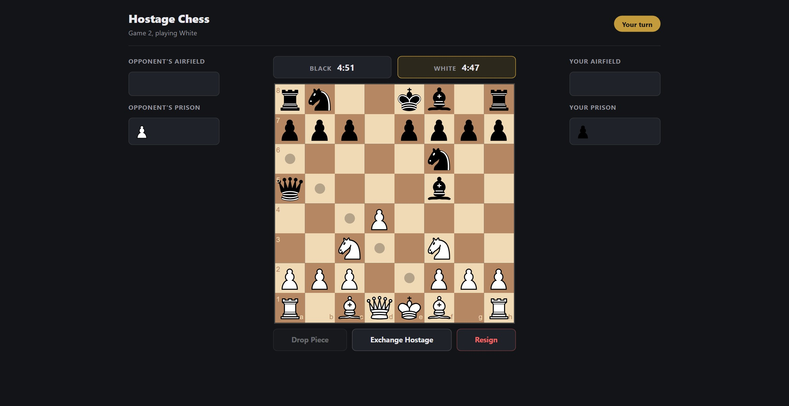
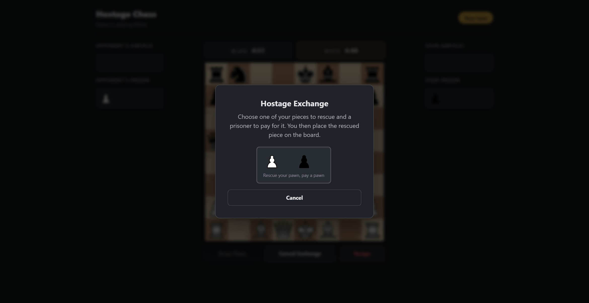
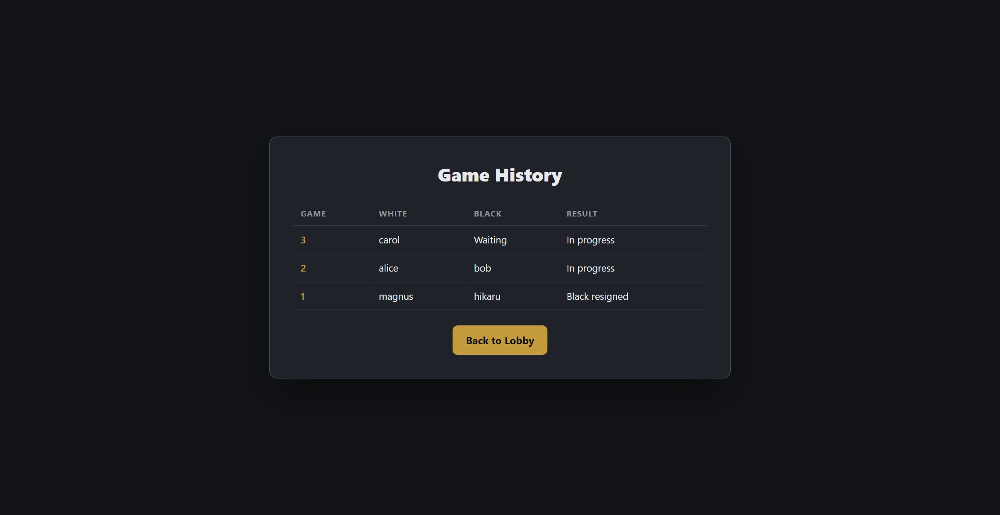

# Hostage Chess

[](https://github.com/haseebn19/hostage-chess/actions/workflows/ci.yml)


A web implementation of Hostage Chess with multiplayer games, chess clocks, and game history.

## Screenshots







## Features

- **Hostage Chess Rules**: Captures go to prison, pieces drop from your airfield, hostage exchanges check piece values, and pawns promote by swapping with a piece from the opponent's prison
- **Server-Side Move Validation**: The game engine checks moves before updating the board
- **Multiplayer**: Automatic matchmaking and HTTP polling for opponent updates
- **Timed Games and Resignations**: 5-minute chess clock per player with automatic timeout handling and a manual resignation option
- **Game History**: Browse past games and see the board after every move
- **Game Interface**: Dark theme with a draggable board built with chessboard.js

## Prerequisites

- Python 3.11+

## Installation

```bash
git clone https://github.com/haseebn19/hostage-chess.git
cd hostage-chess

# Create virtual environment
python -m venv .venv

# Activate virtual environment
# On Windows:
.venv\Scripts\activate
# On macOS/Linux:
source .venv/bin/activate

# Install the package
pip install .
```

## Usage

```bash
hostage-chess 8080
```

`python -m hostage_chess 8080` does the same. Games are saved to `hostage_chess.db` in the directory you start the server from.

1. Open `http://localhost:8080` in your browser
2. Enter a player handle and click **Play**
3. Open a second browser window, enter a different handle, and join the game
4. Drag pieces to move. Use **Drop Piece** and **Exchange Hostage** for the hostage rules

Each player's game page link includes a private key, so only that player can move or resign for their side. To return to a game after closing it, reopen the same link.

## Development

### Setup

```bash
# Create and activate virtual environment
python -m venv .venv
# On Windows:
.venv\Scripts\activate
# On macOS/Linux:
source .venv/bin/activate

# Install in editable mode with dev dependencies
pip install -e ".[dev]"
```

### Testing

```bash
pytest
```

With coverage:

```bash
pytest --cov --cov-report=html
```

The browser tests in `tests/test_browser.py` play through the game page in Chromium. They are skipped unless Playwright is installed:

```bash
pip install -e ".[dev,browser]"
playwright install chromium
pytest tests/test_browser.py
```

### Linting

```bash
ruff check .
ruff format --check .
```

## Building

```bash
pip install build
python -m build
```

Output location: `dist/`

## Project Structure

```text
hostage-chess/
+-- src/hostage_chess/
|   +-- engine/            Pure-Python chess engine
|   |   +-- board.py       Board state, FEN, and serialization
|   |   +-- moves.py       Legal move generation
|   |   +-- hostage.py     Prisons, airfields, drops, and exchanges
|   |   +-- result.py      Checkmate and stalemate detection
|   +-- server/            HTTP server
|   |   +-- app.py         Routes, request validation, and game actions
|   |   +-- database.py    SQLite storage
|   |   +-- templates.py   HTML pages
|   +-- static/            Styles, the game script, piece images, and vendor libraries
+-- tests/                 Engine, database, server, static asset, and browser tests
+-- pyproject.toml         Package, Ruff, and pytest configuration
```

## Credits

- [chessboard.js](https://chessboardjs.com/) - Board rendering and piece drag-and-drop
- [jQuery](https://jquery.com/) - DOM manipulation (required by chessboard.js)
- [Chess Pieces Sprite](https://commons.wikimedia.org/wiki/File:Chess_Pieces_Sprite.svg) - SVG chess pieces by jurgenwesterhof, adapted from work by Cburnett, used under [CC BY-SA 3.0](https://creativecommons.org/licenses/by-sa/3.0/)

## License

This project is licensed under the [MIT License](LICENSE). The chess piece images keep their own CC BY-SA 3.0 license.

---

*Originally developed for CIS\*2750 at the University of Guelph.*
